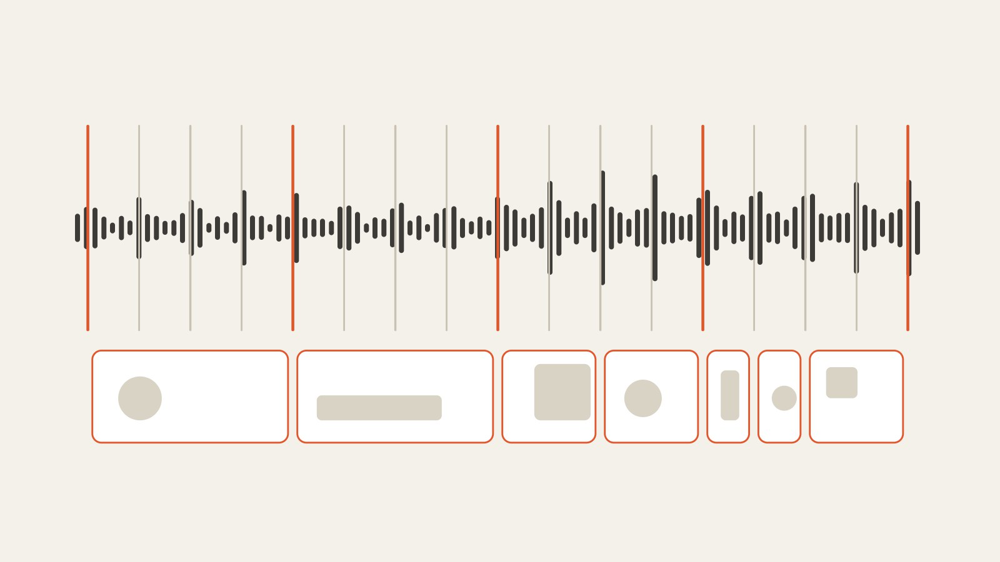

# beat-cut

An [OpenFilm](https://github.com/openfilm/openfilm) skill: a film cut to its music. Every change of picture lands on
a beat, scene changes land on the first beat of a bar, the strongest shot sits where the music lifts, and shots run
longer in the quiet parts than in the loud ones.

| | | |
| --- | --- | --- |
|  | [Cut on the beat](skills/beat-cut) | A film cut to its music: every change on a beat, scene changes on the bars, the best shot where the music lifts. |

An agent can't hear. It can read numbers, so the skill's one script measures the music and the film's cuts:

```sh
node skills/beat-cut/scripts/beats.mjs <music>            # beats/<name>.json and beats/<name>.html
node skills/beat-cut/scripts/beats.mjs snap beats/<name>.json 12.4 30.1 --to bar
node skills/beat-cut/scripts/beats.mjs check               # in the film's folder: every cut, in frames from a beat
```

The measure (`openfilm-beats/1`) has the tempo, every beat, the first beat of each bar, the hits that stand out from
the onsets around them, each bar's level, quiet / mid / loud sections (the fewest stretches, two bars or more, that
fit the bars' levels, each named by its mean, so bars that swing between quiet and mid stay one stretch), the
bar where the music rises most, and the beat where it rises most found without the bars. The run prints the sections.
The page draws the beats, bars, hits and the quiet and loud sections over the waveform, with a player. `check` reads
film.html, finds the music (the clip named with `--music`, else the longest sound with no `.vtt` beside it, so a
voice-over is never taken for the music), follows its `at`, `#t=` and `speed`, and lists every picture cut over the
music with how many frames it is from the nearest beat (the measure goes to `beats/` beside film.html, or `--out`).
Edges less than half a frame apart are one cut. It also reports a GAP (no picture for half a frame or more, or on any frame),
an OVERLAP of clips on one track, a clip whose `#t=` runs PAST END of its file, the pace (shots and their mean
length in each section of the music), a WARN for four or more shots of one length in a row lasting longer than two
bars, and which clip starts at the lift. `--strict` exits 1 on a cut more than a frame off, a GAP or a PAST END. It
measures against beats only: a cut on a half beat or a hit shows as off.

How it measures: the sound at 22.05 kHz, 40 pitch-spaced bands, onset strength from the rise in each band; the tempo
from the onset strength's autocorrelation, weighted toward 120 BPM; the beats by dynamic programming (Ellis 2007);
the bar's first beat from the kick and bass, the change of harmony bar to bar, and the beat's accent. Node and ffmpeg
only, no packages. A seven-minute track takes under half a minute on a laptop.

How well, measured with `tools/`:

- **Tempo against a library's listed BPM**: 9 of 10 Incompetech tracks within 1 BPM. The tenth (Realizer, 125) reads
  at half, 62.4; the run says "it may also be 124.8 BPM" and `--bpm 124.8` measures 125.3.
- **Beats and bars against a score**: 14 renders from XSXB-Band, whose MIDI gives the true grid. The 11 with a clear
  beat: tempo right in all 11, beats F-measure 0.86 to 1.00, bars 0.82 to 1.00 (70 ms tolerance). The 3 ambient beds
  (60 and 72 BPM) fail; all three report `steady` under 0.25, which the run and the brief treat as "little beat: cut
  on the hits and phrases".
- **Synthetic drift**: tempo ramps (100 to 112, 90 to 80 BPM) and 12 to 15 ms of played looseness: beats F 0.99 to 1.00.

When the bars are a guess (the run says so), `--bar <a second that starts a bar>` sets them; `--bpm` sets the tempo.
If the music lifts, the run suggests `--bar` at the beat where it lifts, found beat by beat (the `lift` itself is one
of the guessed bars, so it cannot confirm them); otherwise it says to ask the person to listen. It names another tempo
only at double or half the one it chose.

What the brief asks of the agent:

- measure the music before the first cut; every cut on a beat, half beat or hit within a frame, or in a pause of
  speech, and the cuts left off the beat named;
- the music's shape as the film's: longer shots when quiet, shorter when loud, scene changes on bars, the strongest
  shot on the lift, nothing new in the last bar;
- built in phrases: a whole number of 4- or 8-bar phrases before the lift, the end on a phrase's end or a faded last
  bar;
- every clip looked at before the lift shot is chosen, and each shot's best moment picked with `#t=`;
- a pace a viewer can follow: one beat at the fastest for a picture, two or more for words or a face;
- music that suits the film, low under speech;
- footage trimmed, never re-encoded or sped up to fit a beat;
- `check` passing is not the cut being done: its pace summary and warnings are read, and `look` shows the cut at the
  lift and one in each section.

## Use it

- **In OpenFilm**: open Skills, add one from a link, and paste `https://github.com/WEBGRS/openfilm-beat-cut`.
- **In your own agent** (Claude Code, Codex and others): `npx skills add WEBGRS/openfilm-beat-cut`.

It needs Node 22 or later and ffmpeg on the PATH (OpenFilm needs ffmpeg too). It pairs with
[footage-cut](https://github.com/WEBGRS/openfilm-footage-cut), which logs a folder of clips shot by shot.

## Develop

```sh
npm test            # synthetic music with a known grid and a lift, film.html parsing, check (about 15 s)
npm run check       # the skill folder against OpenFilm's skill rules
node tools/oracle-xsxb.mjs <XSXB-Band exports folder>                 # a local folder of renders, not in this repository
node tools/oracle-tempo.mjs <music folder> <incompetech pieces.json>   # local downloads too
node tools/drift.mjs
```

## 中文说明

OpenFilm 技能：跟着音乐剪片。每次换画面都踩在拍子上，换场景落在小节第一拍，最好的镜头放在音乐起来的地方，安静的段落镜头长、热闹的段落镜头短。

智能体听不见，但能读数字，所以这个技能唯一的脚本把音乐和片子的剪辑点都变成数字：`beats.mjs <音乐>` 测出速度、每一拍、每小节第一拍、比周围更突出的重音、每小节的响度、安静/中等/热闹的段落（用最少的、至少两小节长的段落去贴合各小节响度，按段落平均响度命名，所以在安静和中等之间来回跳的小节会归成同一个段落）、音乐上扬最多的那一小节，以及不靠小节、逐拍找出的上扬那一拍，写成 `beats/<名字>.json` 和一张能播放的波形页，并在命令行打印各段落；`snap` 把秒数吸附到最近的拍、半拍、小节或重音；`check` 读 film.html，找到音乐（`--music` 指定的那段，否则是旁边没有 `.vtt` 的最长一段声音，所以不会把配音当成音乐），按它的 `at`、`#t=`、`speed` 换算，逐个列出音乐范围内的画面剪辑点离最近的拍子差几帧（测量结果写到 film.html 旁边的 `beats/`，或 `--out` 指定的文件夹），相距不到半帧的边缘算同一个剪辑点。它还会报告 GAP（没有画面的空档：长达半帧，或盖住了某一帧）、同一轨上的 OVERLAP、`#t=` 超出文件长度的 PAST END、节奏（音乐每个段落里有几个镜头、平均多长）、连续四个以上等长且总长超过两小节的镜头的 WARN（是不是按时钟剪的？），以及上扬那一刻是哪个镜头开始。`--strict` 在有超过一帧的点、GAP 或 PAST END 时返回 1；它只对照整拍，剪在半拍或重音上的点也会显示为偏离。只用 Node 和 ffmpeg，七分钟的曲子半分钟以内测完。

需求书要求智能体：剪第一刀前先测音乐；每个剪辑点在一帧内落在拍、半拍或重音上（说话停顿处除外），偏离的要说明；片子的形状跟音乐走：安静时镜头长、热闹时短，换场景落在小节上，最强的镜头放在上扬处，最后一小节只放结尾；按乐句搭：上扬前留整数个 4 或 8 小节的乐句，结尾落在乐句末尾或淡出最后一小节；选上扬镜头前看完每段素材，用 `#t=` 挑每段里最好的那一刻；镜头长到看得清：画面最快一拍，有字或人脸两拍以上；音乐配得上片子，有人说话时压低；素材只裁不重编码、不变速；`check` 通过不等于剪完：要读它的节奏汇总和警告，用 `look` 看上扬处和每个段落各一个剪辑点。

准确度（`tools/` 里的脚本可复现）：Incompetech 10 首对照官网标注的 BPM，9 首误差在 1 BPM 内，第 10 首（Realizer，125）测成一半 62.4，脚本会提示「也可能是 124.8」，加 `--bpm 124.8` 后测得 125.3。XSXB-Band 渲染的 14 首（MIDI 给出真实节拍）里，节拍清楚的 11 首速度全对，节拍 F 值 0.86–1.00，小节 0.82–1.00；3 首氛围铺底失败，它们的 `steady` 都低于 0.25，脚本和需求书都会按「节拍不明显，按重音和乐句剪」处理。小节第一拍拿不准时脚本会说，可以用 `--bar <某个小节开头的秒数>` 指定：音乐有上扬时，脚本建议用逐拍找出的上扬那一拍作 `--bar`（`lift` 本身就是按猜出来的小节算的，不能反过来证明小节对），没有上扬就请人去听波形页。另一个速度只在选中速度的两倍或一半处提示。

**安装**：在 OpenFilm 的技能页点「添加 skill」，粘贴 `https://github.com/WEBGRS/openfilm-beat-cut`；用自己的智能体就运行 `npx skills add WEBGRS/openfilm-beat-cut`。需要 Node 22 以上和 PATH 里的 ffmpeg。和 [footage-cut](https://github.com/WEBGRS/openfilm-footage-cut)（把一堆素材按镜头列清楚）配合使用。
